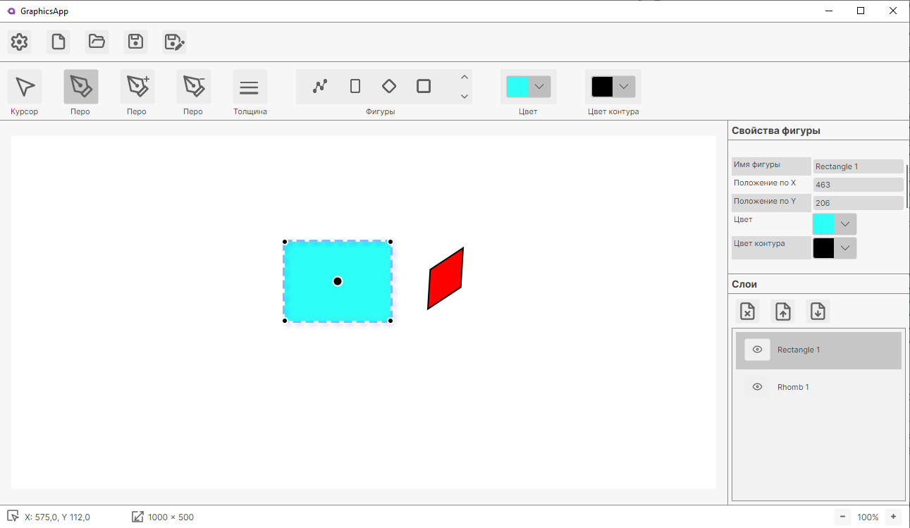
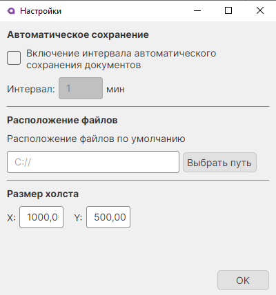

# Vector Graphics Editor

Векторный графический редактор с поддержкой создания, редактирования и экспорта фигур. Написан на C# с использованием Avalonia UI и CommunityToolkit.Mvvm.

## ✨ Возможности

- **Создание фигур**: круг, эллипс, прямоугольник, квадрат, треугольник, шестиугольник, ромб, полигон, кривая Безье.
- **Редактирование**:
  - перемещение, поворот, масштабирование (в т.ч. отражение);
  - изменение толщины и цвета обводки, цвета заливки;
  - работа с точками полигонов и кривых Безье (добавление/удаление/перемещение).
- **Слои**: управление порядком отображения, переименование, скрытие/показание.
- **История действий**: отмена/повтор (Undo/Redo) для всех операций.
- **Экспорт**: JSON (сохранение/загрузка проекта), SVG, PNG.
- **Настройки**: размер холста, автосохранение, выбор папки.
- **Интерфейс**: тёмная/светлая тема (если есть), панель инструментов, строка состояния.

## 🛠 Технологии

- **Платформа**: .NET 8
- **UI**: Avalonia 11
- **MVVM**: CommunityToolkit.Mvvm
- **Внедрение зависимостей**: MEF (System.Composition)
- **Сериализация**: System.Text.Json
- **Экспорт**: собственные экспортёры (SVG, PNG)

## 📸 Скриншоты

*(Добавьте 2–3 скриншота интерфейса. Например:)*




## 🚀 Установка и запуск

### Требования
- .NET 8 SDK
- Visual Studio 2022 / JetBrains Rider / VS Code (опционально)

### Сборка и запуск
```bash
git clone https://github.com/Humble-proger/VectorGraphicsEditor.git
cd VectorGraphicsEditor
dotnet restore
dotnet run --project VectorGraphicsEditor
